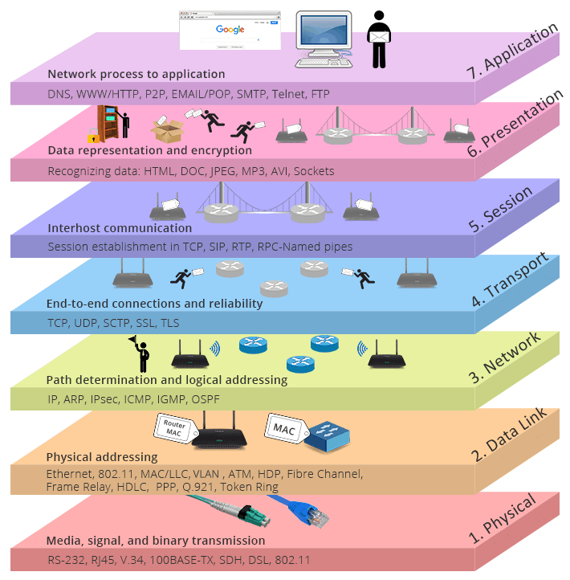

# OSI参照モデル
## プロトコル
通信におけるルールのことを**プロトコル**という。送信側と受信側で同一のプロトコルでなければ、データの疎通はうまくいかない。

## プロトコルスタック
通信における様々なプロトコルを役割ごとにまとめたものを**プロトコルスタック**or**ネットワークアーキテクチャ**or**プロトコルスイート**と呼ぶ。

昔、各メーカは自社製品同士でしか使用できないプロトコルスタックをそれぞれ作っていた。各メーカのプロトコルスタックは互換性がなく、ネットワークを構築するいは、同一メーカのPCで揃えるしかなかった。

この状況を打破するために、異なる機種間でも通信できる世界標準のプロトコルスタックとして作られたのが**OSI参照モデル**。OSIは**Open System Interconnection**の略。
**ISO**(International Organization for Standardization: 国際標準化機構)によって策定された。

## OSI参照モデル
OSI参照モデルはネットワークで必要とされる機能を**7つのレイヤ**(階層)に分割し、それぞれのレイヤで必要になるプロトコルを定義している。各レイヤはレイヤ1・レイヤ2...、あるいはL1・L2
...と呼ばれることもある。
レイヤごとにプロトコルを切り分けること(**階層化**)で各プロトコルの役割が明確になり、変更があっても最小限の変更で済むといったメリットがある。

画像は[こちら](https://www.qsfptek.com/ja/qt-news/tcp-ip-vs-osi-what-is-the-difference.html?srsltid=AYCX9vLYuH_5hG0LvtGuZa6tvCbz3h1a8ZNc-mAMFPQNAjWPffGbo83o)より引用

### レイヤ1：物理層
**物理層**は、機器や電気信号に関するプロトコル群。2つのノードの間で確実に通信するために必要なプロトコルが定義される。

### レイヤ2：データリンク層
**データリンク層**は、隣接ノード間の通信に関するプロトコル群。
2つのノードの間で確実に通信するために必要なプロトコルが定義される。

### レイヤ3：ネットワーク層
**ネットワーク層**は、エンドtoエンドの通信に関するプロトコル群。
ネットワークを跨いだエンドtoエンドの通信をするために必要なプロトコルが定義される。
**エンドツーエンド**とは、データの送信元と宛先を結ぶ通信経路全体のこと。

### レイヤ4：トランスポート層
**トランスポート層**は、通信における信頼性に関するプロトコル群。
通信の方式、通信状態の確認方法、異常発生時の対処など、通信が期待通り行われるためのプロトコルが定義される。

### レイヤ5：セッション層
**セッション層**は、アプリケーション間の接続に関するプロトコル群。
アプリケーション同士の論理的な接続に関するプロトコルが定義されている。

### レイヤ6：プレゼンテーション層
**プレゼンテーション層**は、ユーザが見て触れるデータに関するプロトコル群。
文字・画像・動画といったユーザが扱うデータの変換に関するプロトコルが定義される。

### レイヤ7：アプリケーション層
**アプリケーション層**は、アプリケーション特有のプロトコル群。
電子メール・Webページの閲覧・ファイル転送といったユーザが操作するアプリケーションの動作を支えるプロトコルが定義される。

## カプセル化・非カプセル化
送信データを各レイヤで処理していく際に、**ヘッダ**という制御情報を付加する。
データリンク層ではヘッダに加えて**トレーラ**と呼ばれるエラーチェック用の情報も付加する。
この送信データを作るためにレイヤごとにヘッダ(+トレーラ)を付加していく処理を**カプセル化**という。

受信データは各レイヤで処理されて行く毎に送信時に付加されたヘッダ(＋トレーラ)を外される。
この処理を**非カプセル化**という。

データ+ヘッダ(+トレーラ)のデータ単位を**PDU**(**Protocol Data Unit**)という。
PDUはどのレイヤのヘッダが付加されているかで呼び名が変わる。
特に**フレーム**(**L2：データリンク層**)、**パケット**(**L3：ネットワーク層**)、**セグメント**(**L4：トランスポート層**)という呼び名が代表的である。