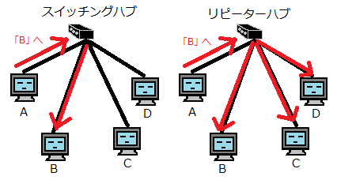
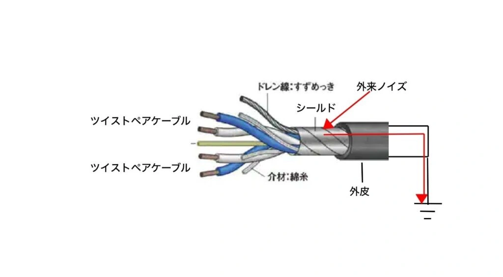
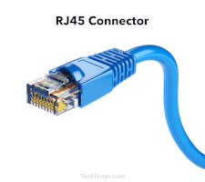
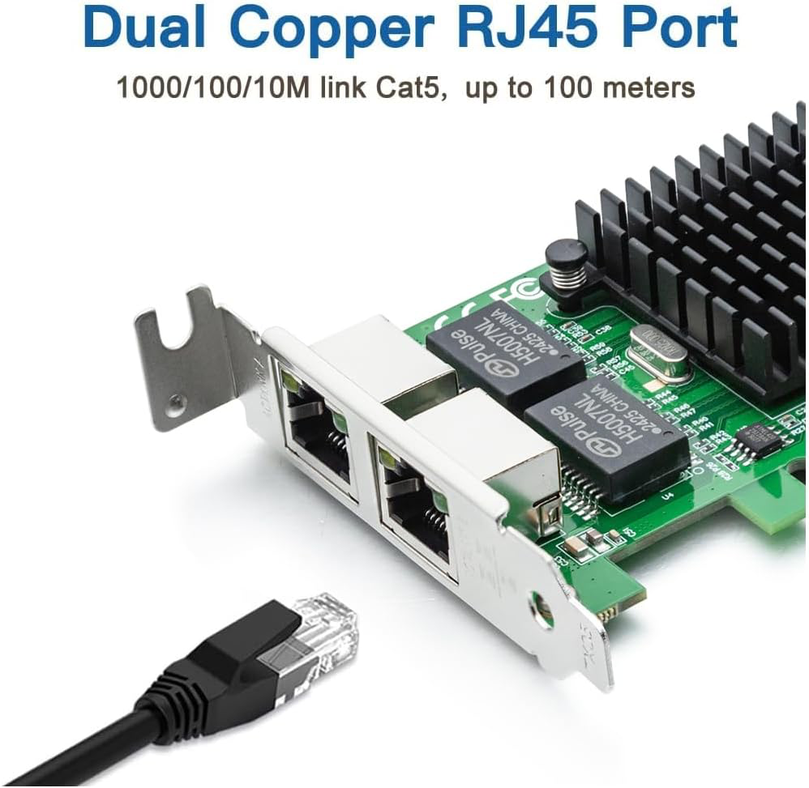
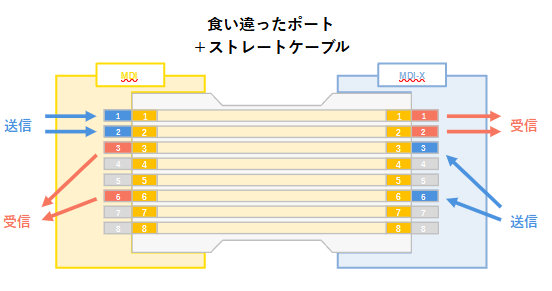
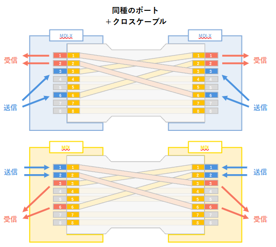
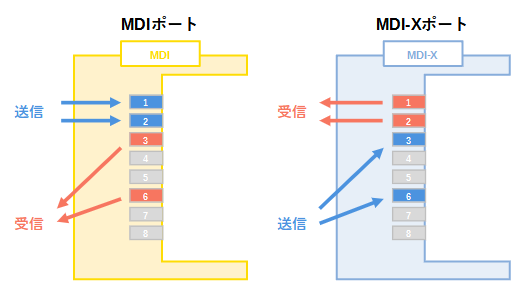
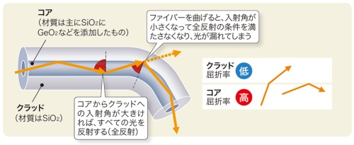
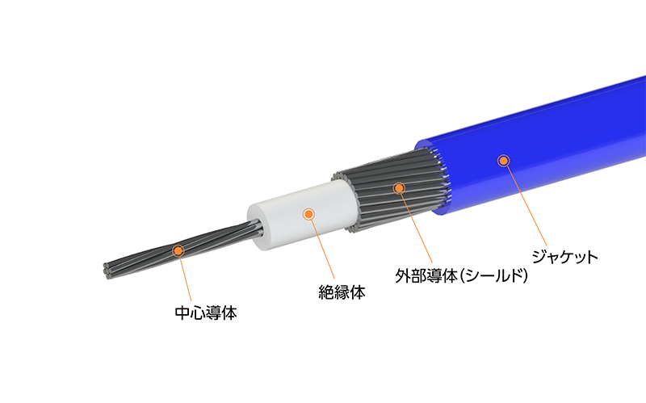
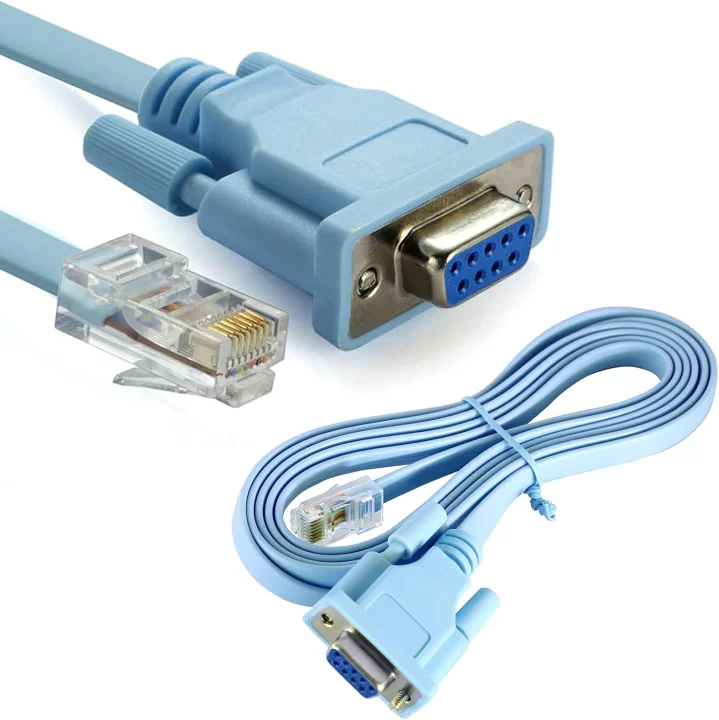

# ケーブルとネットワーク機器
## 代表的なネットワーク機器
クライアントやサーバといったコンピュータ以外に、ネットワークを構築するためのハードウェアである**ネットワーク機器**もノードに含まれる。
複数のノードを繋げる集線装置を**ハブ**(**リピータハブ**)という。宛先以外にもデータを転送してしまう。
送りたいノードのみに送ることのできる頭のいいハブを**スイッチ**(**スイッチングハブ**)という。

ハブやスイッチと違って隣接していないノードとの通信を可能にし、異なるネットワークを相互接続することのできるネットワーク機器を**ルータ**という。

ネットワーク機器はレイヤ別に役割分担している。**ハブはレイヤ1**、**スイッチはレイヤ2**
、**ルータはレイヤ3**でネットワークを構築するために必要な機能をそれぞれ提供している。

## ハブ

画像は[こちら](https://wa3.i-3-i.info/diff98hub.html)より引用

ハブは通信データを単なる電気信号としてしか扱わない物理層で働く装置(**L1デバイス**)の１つ。
複数のノードを繋ぎ、双方の通信を可能とする**集線装置**としての機能と、減衰してしまった電気信号を増幅し、波形を再生して中継する機能である**リピータ機能**を有する。**特定の宛先を選んで送るといった制御機能はない**。
正式名称は**リピータハブ**だがシスコではこれをハブと呼んでいる。

## ツイストペアケーブル

画像は[こちら](https://tohan-denshi.co.jp/technical-information/8291/)より引用。

2本のより合わせ×4セットの計8本の芯線を使ったケーブルを**ツイストペアケーブル**という。
2本のよりによってノイズの発生と影響を抑えられる、**現在のLANで最も使用されている**ケーブル。
シールドのありなしで**UTPケーブル**(Unshielded Twisted-Pair)と**STPケーブル**(Shielded Twisted-Pair)の2種類に分類される。
伝送可能な距離(セグメント長)は**約100メートル**。

ツイストペアケーブルは品質によってカテゴリに分けられる。
**LANではカテゴリ3**(**Cat3**)**以上**のものしか使用できない。
カテゴリの数値が上がれば上がるほど高速&高品質な通信が可能になる。

## RJ-45コネクタ

画像は[こちら](https://techterms.com/ja/definition/rj45)より引用。

ケーブルの末端に取り付ける接続装置をコネクタという。
ツイストペアケーブルで一般に使用されている8芯のコネクタが**RJ-45コネクタ**。
多くのNIC、ネットワーク機器がRJ-45に対応している。

## ネットワークインタフェースカード(NIC)

画像は[こちら](https://www.amazon.co.jp/Gigabit-ネットワークカード-E1G42ET-ロープロファイルのイーサネットカード-Windowsサーバー/dp/B074PQWQB5)より引用。

コンピュータをネットワークに繋ぐための拡張部品を**NIC**(**Network Interface Card**)という。
LANカード、ネットワークアダプタ、ネットワークカードとも呼ばれる。
有線LAN、特にイーサネットに対応するものが多い。

## ストレートケーブル/クロスケーブル

画像は[こちら](https://kanda-it-school-kensyu.com/network-basic1-contents/network-basic1_ch03/network-basic1_0304/)より引用。

ツイストペアケーブルは銅線の並びで**ストレートケーブル**か**クロスケーブル**の2種類に分類される。
ストレートケーブルは両端のピンが同じ並びで製造されている。
クロスケーブルは銅線が交差状態になって製造されている。
通信規格によって1-3, 2-6のピン同士が交差状に接続されたものと、1-3, 2-6, 4-7, 5-8のピン同士が交差状に接続されたもの(全ての銅線が交差する)とが使い分けられる。

## MDI/MDI-X

画像は[こちら](https://kanda-it-school-kensyu.com/network-basic1-contents/network-basic1_ch03/network-basic1_0304/)より引用。

ポート(**モジュラージャック**ともいう)は何番ピンからデータを送受信するかで**MDI**, **MDI-X**のどちらかに分類される。
***1,2番で送信/3,6番で受信するものがMDI, 1,2番で受信/3,6番で送信するものがMDI-X**。

**ストレートケーブルは食い違ったポート**(**MDI - MDI-X**)**の接続で使用する。**
同種のポート(MDI - MDI, MDI-X - MDI-X)間の接続でクロスケーブルを使用すると通信に失敗する。

**クロスケーブルは同種のポート**(**MDI - MDI, MDI-X - MDI-X**)**の接続で使用する。**
食い違ったポート(MDI - MDI-X)間の接続でクロスケーブルを使用すると通信に失敗する。

ノードによってMDI/MDI-Xのどちらのポートを持つか決まっている。
**MDIを持つノード：PC(NIC), ルータ**
**MDI-Xを持つノード：ハブ、スイッチ**

## 光ファイバーケーブル

画像は[こちら](https://active.nikkeibp.co.jp/atcl/act/19/00281/041900001/)より引用。

コンピュータからの電気信号を光信号に変換して伝送するケーブルを**光ファイバケーブル**という。
光の通り道からなる**コア**とコア内に光を閉じ込める**クラッド**とそれらを包む外被で構成される。
光信号は電気信号と違いノイズが発生せず、長距離通信・超高速データ通信が可能になる。(但し高価)
伝送可能な距離(セグメント長)は500m~数kmと非常に長い。

コアの直径が小さく(約9μm)１つのモード(光信号)で伝送する光ファイバケーブルを**シングルファイバ**(**SMF**)という。高速で長距離伝達が可能だがコア部分が繊細で取り扱いが難しくコストも高くつく。
コアの直径が大きく(約50μm)複数のモードで伝送する光ファイバケーブルを**マルチモードファイバ(MMF)**という。各モードで到達までの時間がばらつくため低速で短距離伝送向けとなる。頑丈で安価に導入が可能。

## その他のケーブル

画像は[こちら](https://www.i-pex.com/ja-jp/product/micro-coaxial_twinaxial)より引用。

**同軸ケーブル**はLUNの普及の初期で広く使われていたケーブル。ノイズの遮断に優れ、質の高い信号の伝送が可能なため、現在でもテレビなどで広く利用されている。

画像は[こちら](https://item.rakuten.co.jp/maveek/hks02024-bl/)より引用。

**シリアルケーブル**は**WAN接続で主に使用される**ケーブル。ルータなどの機器によって様々な規格が存在する。

