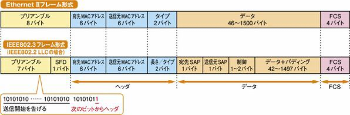

# イーサネット
## イーサネット
イーサネット(Ethernet)は物理層〜データリンク層を規定するコンピュータネットワークの一つ。
LANの物理層〜データリンク層はほとんどがイーサネット規格で設計されている。現在ではLANだけでなくWANにも利用が広がるなど、ネットワークの発展と共に進化し続けている規格である。

## イーサネットの仕様
イーサネットには**DIXイーサネット**と**IEEE 802.3**の２つの規格が存在する。
IEEE(Institute of electrical and Electorinics Engineers: 米国電気電子技術者協会)はLANの標準化を推進する団体でネットワーク技術の発展に伴いイーサネットの進化に寄与し続けている団体。

## IEEE仕様
IEEEはデータリンク層を更に**MAC副層**(Media Access Control)と**LLC副層**(Logical Link Control)に分けた。
MAC副層ではケーブルや無線といった伝送媒体に依存するフレームの伝送方式に関するルールを定義。イーサネットはIEEE802.3、トークンリングはIEEE802.5といった具合で媒体ごとに規格が定義される。
LLC副層は媒体に依存しない**IEEE802.2**という共通規格を定義。

## イーサネットのフレーム

画像は[こちら](https://ascii.jp/elem/000/000/427/427324/)より引用。

イーサネットで扱われるフレームは**DIX仕様**と**IEEE802.3仕様**の2種類。インターネットを支えるTCP/IPで使用されているという理由から**DIX仕様が一般的**となっている。
DIX仕様もIEEE802.3仕様も構造は似ており、イーサネットで動作する全てのノードはどちらにも対応している。
フレームを構成する一つ一つの要素を**フィールド**という。

## MACアドレス
**MACアドレス**はコンピュータのNICやネットワーク機器の各ポートに対し製造時に重複なしに付与された番号(アドレス)で、フレームの送信元や宛先を識別するためにデータリンク層(レイヤ2)で利用される。
物理アドレス、ハードウェアアドレスとも呼ばれる。
48ビット(6バイト)からなり、16進数12桁で「-」「:」「.」のいずれかで区切って表記される。

## MACアドレスの構成
例：00-00-0A-11-F4-5C
MACアドレスの前半24ビットは**OUI**(Organization Unique Identifier)と呼ばれるIEEEが各製造会社に割り当てた番号を表す。OUIはベンダーコードとも呼ばれる。
後半24ビットは各製造会社が製品に割り当てた番号を表す。シリアル番号とも呼ばれる。

## 特別なMACアドレス
ユニキャストで送信したい場合は宛先に相手のMACアドレスを指定する。
ブロードキャストで送信したい場合は宛先に**ブロードキャストMACアドレス**(**FFFF.FFFF.FFFF**)を指定する。この際送信されるフレームは**ブロードキャストフレーム**と呼ばれる。
ユニキャストで送信したい場合はマルチキャストグループに設定された**マルチキャストMACアドレス**を指定する。

## イーサネット規格の命名規則
例：100BASE-TX
IEEE802.3は伝送媒体に応じて様々な規格が用意されている。
企画の命名は「**通信速度**(100)」「**伝送方式**」(BASE)「**ケーブルの種類**」(TX)の3部で構成される。

## オートネゴシエーション
ノード間の通信企画の違いをハンチし、最適な通信規格を自動で選ぶ機能を**オートネゴシエーション**という。
オートネゴシエーションが有効な機器同士、互いに**FLP**(**Fast Link Pulse**)という自信の通信規格を知らせる信号を送り合うことで擦り合わせを行う。
オートネゴシエーション非対応機種はNLP(Normal Link Pulse)やアイドル(idle)という信号を発している。

## イーサネットの媒体アクセス制御(CSMA/CD)
**CSMA/CD**はイーサネットで使用される媒体アクセス制御方式の一つ。

- CS：**キャリアセンス**(Carrier Sense)。データを送信できるかを確認する。**キャリア**(ネットワーク伝送中の信号)がない状態(アイドル状態)が一定時間(**IFG**：Interframe Gap)続くとデータ送信可能と判断する。
- MA：**多重アクセス**(Multiple Access)。ネットワーク上の全てのホストに送信権利が平等に与えられている。
- CD：**衝突検出**(Collision Detection)。衝突を検出し、**バックオフ**で再送処理を行う。
送信ホストは衝突検出すると送信を中止。直ちに衝突発生を知らせる信号(**ジャム信号**)が全てのホストに送信される。

## 全二重通信/半二重通信
**全二重通信**(full duplex)は送信/受信を同時に行える通信方式。**半二重通信**(half duplex)は不可なもの。
全二重通信の方が通信速度・効率が良く、コリジョンも起こらない。現在は二重通信が一般的。
CSMA/CDは半二重通信のイーサネットで用いられる。コリジョンの起らない全二重通信では不要。

## 全二重通信の条件
全二重通信は以下の3つの条件を満たさなければ実現できない。
- ノードが全二重通信をサポートしている。
- 集線機器がスイッチである。(ハブを使うと半二重通信になる。)
- ポイントツーポイント(1:1)接続である。

## リピータ
**リピータ**はリピータ機能(波形の増幅・再生)のみを持ったレイヤ1で動作するネットワーク機器。ハブから集線機能を除いたもの。

## レイヤ2デバイスの特徴
ブリッジやスイッチといったL2デバイスはL1デバイスと違いフレームを読み取ることからMACアドレス、つまりノードを識別するための情報を扱うことができる。
これを学習することにより、送る必要のないノードには送らないといった制御ができるようになる。

## フィルタリング
スイッチもブリッジも宛先MACアドレスがどのポートに接続されているかを判断し、接続のあるポートのみフレームを転送する。これを**フィルタリング**と呼ぶ。
フィルタリングは適切なポートを選んで送り出すというより、全てのポートから送り出すというハブの機能に不適切なポートを閉じる機能が加わったものとイメージするとよい。

スイッチもブリリッジも接続されているデバイスのMACアドレスとそのポートの対応表を**MACアドレステーブル**に記憶している。
フィルタリングはMACアドレステーブルを照合することで行われる。
シスコでは**CAMテーブル**(Content Addressable Memory Table)と呼んでいる。

作成手段は**ダイナミック**(動的＝デバイスが自動作成)と**スタティック**(性的＝管理者が手動登録)の２種類ある。
ダイナミックでは、フレームの流入があるたびに**送信元MACアドレス**と**受信ポート**を紐ずけて登録する。
なお、動的に作られたデータには**エージングタイム**という有効期限がある。

MACアドレステーブルにフレームの宛先に該当するアドレスが存在しない場合は、スイッチもブリッジもハブと同様に接続先全てに送る。この仕組みを**フラッディング**という。

## スイッチとブリッジの違い
スイッチは転送先のポートを識別するが、ブリッジは「受信側のポートにいるかどうか」しか識別しない。
ブリッジはソフトウェア主体(自前のCPU)で判断するため処理が低速。スイッチはハードウェア主体(ASICというMACアドレス学習や転送といったスイッチング処理ごとに用意されたICチップ)で判断するため処理が高速。
ブリッジは基本的に2ポートしかない。スイッチは3ポート〜数百ポートを持てる。(ポート密度が高い。)

## コリジョンドメイン
コリジョンの伝わる範囲を**コリジョンドメイン**という。(セグメントと呼ぶこともある。)
レイヤ1デバイス(ハブ、リピータ)は全て半二重通信になるため、**接続する全てのリンクがコリジョンドメイン**となる。**カスケード接続**(ハブとハブの接続)するとコリジョンドメインは更に拡大する。
コリジョンドメインが広いとコリジョンの発生確率は上がり、再送処理が増えてパフォーマンスが低下する。

レイヤ2デバイス(レイヤ3デバイスも含む)はMACアドレスから適切なポートのみにデータを送信するという特性から、**ポート毎にコリジョンドメインを分割する**という特性を持つ。(ブリッジは元々その目的で作られた。)
1つのスイッチポートにつき1つホストを接続することでコリジョンドメインを最小分割することを**マイクロセグメンテーション**という。

## レイヤ3デバイスの特徴
レイヤ2デバイスは隣接していないノードとの通信を可能にし、異なるネットワークを相互接続する。
レイヤ3デバイスは複数の経路から最適経路を選択し、パケットを効率的に転送する。(ルーティング)
レイヤ3デバイスは**ポート毎にブロードキャストドメイン(ブロードキャストで届けられる範囲)を分割する**。なお、レイヤ2のデバイスはブロードキャストを中継する。

## ルータとレイヤ3スイッチの違い
L3スイッチはネットワーク層(パケットの処理)に対応できるようにL2スイッチを改良したもののイメージ。このためイーサネットの使用が中心となる。
ルータはイーサネットのみならず様々なWANサービスに対応するネットワーク接続の万能選手。
開発が進んで現在は双方のデメリットが小さくなっており、その差が曖昧になっている。