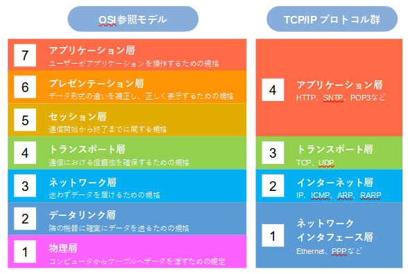

# TCP/IP(インターネット層)
## OSIとTCP/IP
OSIはISOで生まれた理論重視のプロトコルスタックで難易度の高さもあり、あまり普及しなかった。
一方、TCP/IPはアメリカで生まれた実用性重視のプロトコルスタックで、インターネットの普及と共に普及してき、デファクトスタンダードとなっている。

## TCP/IPプロトコルスタック

画像は[こちら](https://kanda-it-school-kensyu.com/network-basic1-contents/network-basic1_ch02/network-basic1_0202/)より引用。

**TCP/IPプロトコルスタック**はインターネットの標準プロトコル＝**デファクトスタンダード**(**実用上の標準**)な通信プロトコルのこと。**RFC**(RFC791)によって標準化されている。
**TCP**と**IP**という2つのプロトコルを中心に、4つのレイヤで構成されている。
OSIプロトコルスタックとTCP/IPプロトコルスタックのレイヤごとの対比は図の通り。

## TCP/IPプロトコルスタック
**RFC**(**Request For Comments**)は主にインターネットに関する技術使用を公開している文書のこと。
RFCに属する文書は全てインターネット上で公開されている。
インターネットの技術標準を定めるIETF(Internet Engineering Task Force)という団体が発行している。

## カプセル化/非カプセル化
TCP/IPにおいてもカプセル化/非カプセル化の概念が存在する。
**PDU**はヘッダを付加したプロトコルによって名称が異なる(トランスポート層のプロトコルがTCPの場合)。

| 層 | 付加されるもの | PDUの名称 |
| --- | --- | --- |
| アプリケーション層 | HTTPヘッダ + データ | メッセージ |
| トランスポート層 | TCPヘッダ | **TCPセグメント** |
| インターネット層 | IPヘッダ | **パケット**(IPデータグラム) |
| リンク層 | Ethernetヘッダ + FCS(トレーラ) | **フレーム** |

## インターネット層～トランスポート層の主なプロトコル
| 層 | 主なプロトコル |
| --- | --- |
| トランスポート層 | **TCP**(信頼性の高い通信を提供)、**UDP**(高速性の高い通信を提供) |
| インターネット層 | **IP**(エンドツーエンドでパケットを伝送する仕組みをゆるく提供)、**ICMP**(IPの補助役。通信状況やエラーを通知)、**ARP**(IPアドレスからMACアドレスを特定) |

## レイヤ3：ネットワーク層
**ネットワーク層**はエンドツーエンドの通信に関するプロトコル群のこと。
ネットワークをまたいだエンドツーエンドの通信をするために必要なプロトコルが定義される。
- データの送信元と宛先の識別方法に関するルール(論理アドレス)
- 経路選択の方法に関するルール
- データの送出方法に関するルール

**エンドツーエンド**はデータの送信元と宛先を結ぶ通信経路全体のこと。

## IP
**IP**(**Internet Protocol**)はネットワーク層/インターネット層で中心的な役割を担うプロトコル。**IPアドレス**を使用してエンドツーエンドの通信を可能にする。
IPアドレスは広いネットワークの世界における住所のようなもの。世界中で重複しないよう設定される。
MACアドレスと違い、個々のノードに付与されるIPアドレスは状況によって変化する(論理アドレス)。

### IPの特徴
- **コネクションレス型**：送りっぱなし。正しく届いたかどうかは関知しない。
- **ベストエフォート型**：保証はしないが最善は尽くすという通信タイプ。信頼性を高めるための簡単な仕組みは提供している。
- **データ回復機能なし**：データを破棄したら破棄しっぱなし(再送信の要求などはしない)。

⇒ 必要であれば他のプロトコル(TCPなど)で補う。

## IPアドレスの概要
IPアドレスにはバージョンが存在し、最も普及しているのが**IPv4**。ただしIPv4は割り振ることのできるアドレスに限界が来ており(**IPアドレス枯渇問題**)、その解消のために現在**Ipv6**の普及が進められている。
IPv4においてIPアドレスは32ビット待ち、ネットワークのアドレスを表す**ネットワーク部**と個々のノードのアドレスを表す**ホスト部**で構成される。

例：`172.1.2.3` = `10101100 00000001 00000010 00000011`

## IPヘッダ(IPv4)の詳細
IPヘッダ(IPv4)はエンドツーエンドの通信で肝となる**送信元IPアドレス**・**宛先IPアドレス**だけでなく、データの送信過程において必要になる情報をフィールドとして多数持つ。
IPヘッダを構成するフィールドのうち、軸となるものは全部で**20バイト**定義されている。
テストやデバッグなどの特別な状況では「オプション設定」として最大40バイトをIPヘッダに追加することができる。

主なフィールドは以下の通り。

| フィールド | 内容 |
| --- | --- |
| バージョン | IPv4かIPv6か |
| ヘッダ長 | IPヘッダの長さ(32bit単位) |
| サービスタイプ(ToS) | データの送信優先度。主に**QoS**に関する制御情報を管理する |
| 最大長 | パケット全体の長さ |
| 識別子 / フラグ / フラグメントオフセット | フラグメント処理に使う情報 |
| TTL(生存時間) | パケットの生存時間 |
| プロトコル | 上位プロトコルを識別するための番号 |
| ヘッダチェックサム | IPヘッダ部分のエラーチェック用 |
| 送信元IPアドレス / 宛先IPアドレス | パケットの送信元/宛先のIPアドレス |
| オプション設定 / パディング | 可変長(0～40バイト) |

### フラグメンテーション
送信データが**MTU**(一度に伝送できる最大サイズ)を超えている場合、データはMTUに収まるサイズへと分割してから送信される。
これを**フラグメンテーション**(断片化)という。断片化することはフラグメント処理と呼ばれる。
例えばMTUが1200バイトで2800バイトのデータを送る場合、1200バイト + 1200バイト + 400バイトに分割され、各断片には識別子・フラグ・オフセットが付けられる。宛先ではそれらが元の2800バイトに組み立て直される。

### TTL(Time To Live)
パケットの生存時間。正確には**ルータを中継できる回数**。
ルータはパケットを中継する度にフィールド内の数値を1減らし、0になると中継を中止して廃棄する。
データがネットワーク上を永遠に転送され続けるといったトラブルを防止する。

### プロトコル(フィールド)
上位のプロトコルを表す番号。どのプロトコルがどの番号かは**IANA**(現ICANN)という組織によって定義された。
(例：ICMPは1、TCPは6、UDPは17)

### 10進数と2進数
- **10進数**：0～9の組み合わせで数値を表現する。1桁で表せるのは0～9の10種類。
- **2進数**：0,1の組み合わせで数値を表現する。1桁で表せるのは0,1の2種類。

### IPアドレスのクラス
| | クラスA | クラスB | クラスC | クラスD |
| --- | --- | --- | --- | --- |
| 用途 | 大規模ネットワーク向け | 中規模ネットワーク向け | 小規模ネットワーク向け | IPマルチキャスト向け |
| 構成の例 | 10.0.0.1 | 172.16.0.1 | 192.168.0.1 | 224.0.0.3 |
| 最大ホスト数 | 16,777,214 | 65,534 | 254 | - |
| 最大ネットワーク数 | 254 | 65,534 | 16,777,214 | - |

## ネットワークを跨ぐ通信(デフォルトゲートウェイ)
ノードが別のネットワーク宛てに通信する場合、データはまず**ルータ**に送られる。
ルータは各ネットワークに接続するポートごとにIPアドレスを持っており(例：192.168.1.254 / 192.168.2.254 / 192.168.3.254)、ノードが他のネットワークへ出ていくときの出入口となるルータのIPアドレスを**デフォルトゲートウェイ**と呼ぶ。

## ARP
**ARP**(**Address Resolution Protocol**)はIPアドレスに紐づくMACアドレス(レイヤ2アドレス)を調べるためのプロトコル。
このIPアドレスからMACアドレスを調べる一連の処理は**アドレス解決**(Address Resolution)と呼ばれる。
ブロードキャストでネットワーク内の全ノードに「このIPアドレスは誰？」という通信(**ARPリクエスト**)を行い、自分と認識したノードにMACアドレスを返答させるという仕組み。フレームの宛先MACアドレスを決定するために必要。
(ブロードキャストの宛先MACアドレスは`FFFF.FFFF.FFFF`)

何度もブロードキャストされることを防ぐために**ARPテーブル**が用いられる。
ARPテーブルに保存された情報を**ARPキャッシュ**といい、一定時間経過すると除去される。宛先IPアドレスがARPテーブルに登録されていればARPリクエストは不要。

### ネットワークを跨いだARPの動作
宛先が別のネットワークにある場合、送り先は**デフォルトゲートウェイ**になる。
そのため送信元ノードは、デフォルトゲートウェイ(ルータのポート)のMACアドレスをARPで調べてフレームを送る。

### ARPコマンド
| 操作 | Windows | Cisco IOS |
| --- | --- | --- |
| ARPテーブルの表示 | `arp -a` | `show ip arp` |
| ARPテーブルの即時クリア | `arp -d` | `clear arp-cache` |

## ICMP
**ICMP**(**Internet Control Message Protocol**)はエラー通知や問い合わせ情報を転送するためのプロトコル。
ベストエフォート型のため通信状況やエラーの確認を行わないIPを補う役割を担い、IPとセットで用いられる。
ICMPはインターネット層のプロトコルであり、IPの上位に位置づけられる。

### ICMPフォーマット
IPヘッダの後ろに、以下のフィールドとデータが続く。
- **タイプ**(8bit)：メッセージの種類を表す番号
- **コード**(8bit)：メッセージの詳細を表す番号
- **チェックサム**(16bit)：エラーチェック用

| タイプ | 意味 | 種別 |
| --- | --- | --- |
| 0 | エコー応答 | Query |
| 3 | 宛先到達不能(コードで具体的な原因を知らせる) | Error |
| 5 | 経路変更 | Error |
| 8 | エコー要求 | Query |
| 11 | 時間超過(TTL超過、分割パケットの組み立て中にタイムアウトした) | Error |

### ping
**ping**は特定のノードと通信できるかを確認する際に用いられるコマンドの一種。
**エコー要求**(タイプ8)を発信し、対象のノードから**エコー応答**(タイプ0)が返ってきたら接続OKと判断する。
(エコー要求を受信したノードは必ずエコー応答を返すことになっている)
通常1回のpingで複数のエコー要求を送る。(Windowsの場合デフォルトで4回送信する)

### traceroute
**traceroute**は特定のノードまでの経路情報を取得するためのコマンドの一種。
コマンドはOSによって異なり、Windowsだと`tracert`、Cisco IOSだと`traceroute`で実行可能。
TTLはルータによって1ずつ減らされるが、0になると該当ルータから送信元にエラー通知(時間超過)が行われる。
tracerouteはこの仕組みを利用しており、TTL=1で送信＆エラー通知してきたノード情報を記録 → TTL=2で送信＆エラー通知してきたノード情報を記録…というようにTTLを増やしながらデータ送信を繰り返すことで経路情報を取得する。

