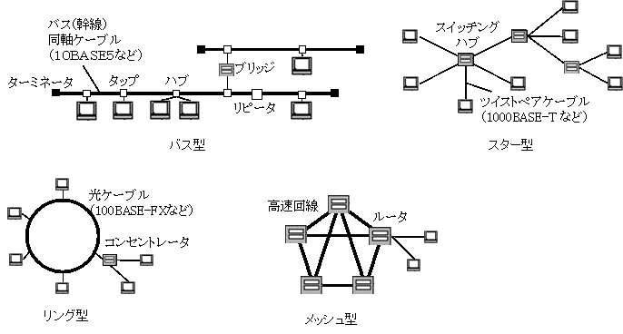

# ネットワーク初歩
## コンピュータネットワーク
**コンピュータネットワーク**とは、コンピュータ同士のつながりのことで、互いにデータの送受信を行う。
### メリット
- データやリソースの共有が可能になる。
- 遠距離でも、多数に対してでも、素早く低コストで情報を発信・受信できる。

## LANとWAN
- **LAN**(Local Area Network)とは、建物内、敷地内などの狭い範囲のネットワーク。自前で構築する。
- **WAN**(Wide Area Network)とは、地理的に離れたLANとLANを結びつけることで構築する広い範囲のネットワーク。**電気通信事業者**(**キャリア**)がサービスを提供する。

## インターネット
**インターネット**は、**プロバイダ**(**ISP: Internet Service Provider**)と呼ばれる通信事業者を介して構築される世界規模のネットワーク。
世界中のネットワークを**TCP/IP**という技術で相互接続している。
WANの一種である。

インターネットの技術(TCP/IP)を用いて作られた社内ネットワークを**イントラネット**という。使用を限定されたアプリケーションや情報を共有することが可能。
複数のイントラネットを結んだものを**エクストラネット**という。

## サーバとクライアント
- ある機能を持ったソフトウェアのことを**アプリケーション**という。
- 自身が保有するアプリケーションのサービスを他に提供するコンピュータを**サーバー**という。
- 他が所有するアプリケーションのサービスを利用する側のコンピュータを**クライアント**という。

## ネットワークユーザアプリケーション
ネットワークを利用したアプリケーションを**ネットワークユーザアプリケーション**という。

その中でも、ユーザの実行やあらかじめ設定されたタイミングで自動実行&終了するものを**バッチアプリケーション**という。
クライアントとサーバ間でデータ通信が発生するものを**インタラクティブアプリケーション**という。
クライアントとクライアント間でデータ通信が発生するものを**リアルタイムアプリケーション**という。

## データが送られる仕組み
コンピュータはどんな情報も**2進数**データに変換して扱う。2進数データは**バイナリデータ**ともいう。
2進数データを送信する際は**電気信号**に変換する。
人間にわかる情報→2進数データ→電気信号→2進数データ→人間にわかる情報という順番で伝達されていく。

ある情報を2進数データに変換することを**符号化**(**エンコード**)、逆に戻すことを**復号化**(**デコード**)という。世に存在する様々な文字に対して1つずつ対応する番号をつけたものを**文字コード**という。EUC, Shift_US, Unicodeなど、文字コードには様々な形式が存在する。

送信側で設定された文字コードと、受信側で設定された文字コードが食い違っていると、受信側で復号化に失敗して、**文字化け**が起きてしまう。

バイナリデータを送信する際は、**0 = 電気OFF**, **1 = 電気ON**に見立てた電気信号へと変換される。受信側も電気信号が到着するとバイナリデータに変換してコンピュータ内で扱えるようにする。

## 帯域幅
1秒間にどれだけの情報を送ることができるかを表す言葉を、**帯域幅**(**bandwidth**)という。
帯域幅の広さに比例して1秒間に送ることのできるデータ量が増えるため、**通信速度と同じ**意味合いで使われるようになり、一般に1秒間に何bit送ることができるかを表す**bps**(**bits per second**)という単位が使用される。

## 通信障害
大量データ通信などが原因でネットワークが混雑し、データ通信が困難になることを**輻輳**(**ふくそう**)という。信号は想定より早くor遅く宛先に到着することがあり、これを**ジッタ**(**jitter: イライラの意味**)という。ジッタはデータの変質・劣化を引き起こし、音声や映像の乱れなどを引き起こす。

## ノードとリンク
**ノード**はネットワークにおける機器のこと。コンピュータ、プリント、ルータなど。**リンク**はノードとノードの間のデータの通り道のこと。ケーブルや電話など。

## トポロジ
**トポロジ**は、ノードの繋ぎ方のこと。コストを抑えたい、耐障害性を強めたいなどの用途に合わせてどのトポロジを選ぶべきかは変わる。

### バス型トポロジ
**バス**と呼ばれる一本の**同軸ケーブル**に複数のノードを接続するトポロジを**バス型トポロジ**という。バスの終端には電気信号の反射によるノイズを防ぐため、**ターミネータ**(**終端抵抗**)が取り付けられている。一箇所でも断線すると、全体が機能しなくなり、拡張性も低いため、現在はあまり使われない。

### スター型トポロジ
1つの**集線装置**(**ハブ**)を中心にノードを接続するトポロジを**スター型トポロジ**(または**ハブアンドスポーク**)という。扱いやすく、対象外や拡張性に優れるため、現在のLAN構築で最も一般的に使用されるトポロジである。

大量ノードに対応するためハブ同士を接続してスター型トポロジを拡張させることがあり、これを**拡張スター型トポロジ**という。

### リング型トポロジ
ノード同士を輪のように繋げたトポロジを**リング型トポロジ**という。**トークン**という信号が周回しており、これを受け取ったノードのみがデータ送信可能になる。順番に送信していくためトポロジ内でデータ競合は発生しない。

### メッシュ型トポロジ
複数のノードを網目上に接続するトポロジを**メッシュ型トポロジ**という。全ノードをつなぐものを**フルメッシュ**、重要なノードに絞ったものを**パーシャルメッシュ**という。コストはかかるが高い**冗長性**(問題が起きても他でカバーできる状態)を持ったトポロジ。

## 通信の種類
ネットワーク内でのデータ通信の方法は**ユニキャスト**(1:1)、**ブロードキャスト**(1:全て)、**マルチキャスト**(1:特定のグループ)の3つが主。